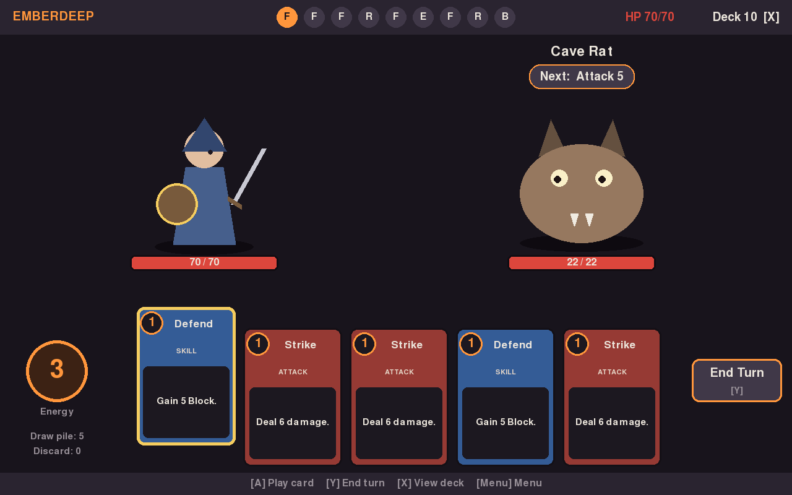
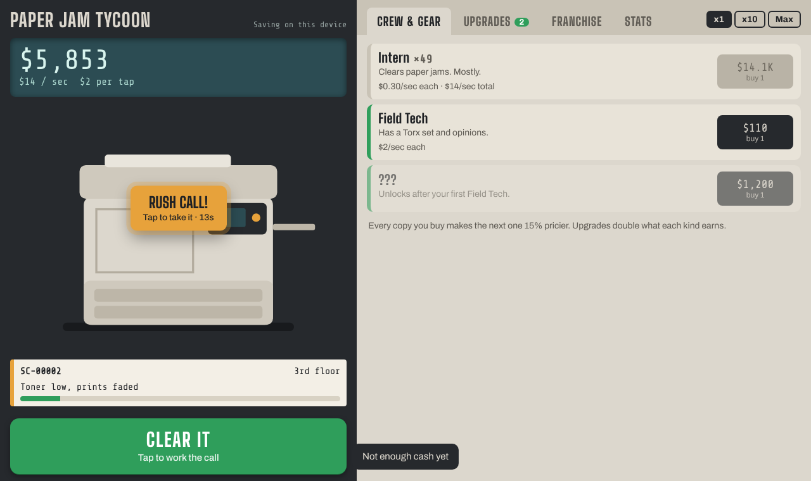
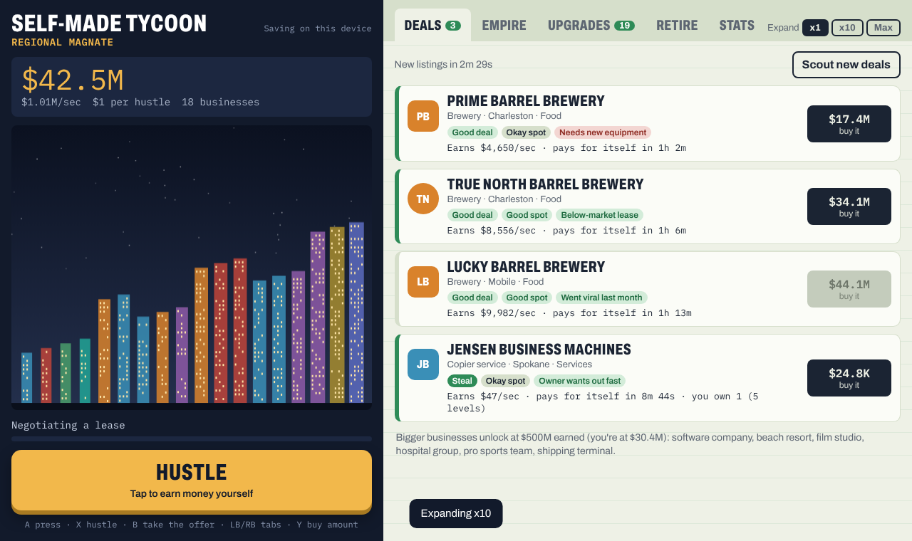

# ClaudeGameTest

A test of how well Claude can build working games from a short brief. Each game started from a one-line request, such as "help me build a game" or "make it a business tycoon". Claude then picked the tools, wrote all the code, tested it and shipped it. Heber plays the results and steers.

The repo keeps every game plus the automated tests Claude wrote for it, so the claims below can be checked and re-run.

## The games

| Game | What it is | Plays on | Built with |
|---|---|---|---|
| [Emberdeep](emberdeep/) | Deck-building dungeon crawl: 9 floors, 18 cards, 8 enemies, a boss | Steam Deck, Linux PC | Python + pygame |
| [Paper Jam Tycoon](paper-jam-tycoon/) | Incremental game: clear copier jams, hire techs, grow a print-service empire | Any web browser (Deck, phone, PC) | One HTML file |
| [Self-Made Tycoon](self-made-tycoon/) | Business tycoon: start with nothing, buy randomly generated real-world businesses, fix them up and flip them, work up to an airline | Any web browser (Deck, phone, PC) | One HTML file |

| Emberdeep | Paper Jam Tycoon | Self-Made Tycoon |
|---|---|---|
|  |  |  |

## How each game was built

1. **Brief.** Heber says roughly what he wants. Claude asks only questions whose answers would change what gets built (genre, platform, how hands-on he wants to be) and decides the rest itself.
2. **Build.** Claude writes the whole game. The rules are kept apart from the drawing code, so they can be tested without a screen. Every file is heavily commented so it can be read and learned from.
3. **Test.** Claude writes two kinds of automated test for each game:
   - **A robot player** plays hours of simulated game time to check nothing crashes and to tune the pace: how long until the boss, the next tier, the first prestige.
   - **A click-through test** drives the real game with fake taps, key presses and controller buttons. It checks each feature and saves screenshots, which Claude then looks at to catch layout problems.
4. **Second look.** Before handing over, Claude re-checks the work for edge cases and fixes what it finds.
5. **Play.** Heber plays it and asks for changes.

## What testing caught

These were real bugs or problems found by the tests or the screenshot review before Heber saw the game:

- **Emberdeep:** the selected card could point past the end of the hand and crash the drawing code. The boss was also too hard (the robot won 15% of runs), so its health was tuned until the win rate reached 32%.
- **Paper Jam Tycoon:**
  - On a brand-new device, the empty game would have counted as newer than the save in your account and overwritten it.
  - The "tap again to sell" confirmation label vanished a quarter second after you tapped.
  - Locked rows that should have been hidden were all showing.
- **Self-Made Tycoon:**
  - The first balance pass let the robot reach the top tier in 14 minutes instead of a few hours. Every business you bought started its own cheap upgrade ladder, so prices now rise with your total levels in each industry.
  - Late in a run, the deals board filled with industries you had already grown huge, which cost billions and took months to pay back. The board now favours industries you own little of.
  - Two click-through checks failed about 1 run in 3. A random buyout event could sell the only test business, and the "corrupted save" check never loaded a broken save, because the game saved a good copy over it as the page closed.
  - Loading a save never repaired broken numbers such as negative cash. The repair step compared each value against itself.
  - Amounts just under a million showed as "$1000K".
  - A buyout offer still paid out for a business you had already sold.
  - The first sale prices let you buy a plain business and sell it straight back at a profit. Sales now go by the business's market price, not its income.
  - Commodities and crypto (caught in the design review before testing): a plain random walk makes the average price creep up by itself, which would have made crypto free money. Each coin's drift now cancels that. Pop-up news only happens if you answer, so a news event about a coin you already held could have been dodged by ignoring it. Those events are now only offered for coins you don't hold.
  - On a phone, a price's "▲ 2.0%" split across two lines, and a brand-new game showed empty charts. Each market now starts with 20 minutes of history.

## What hasn't been tested

- **Real hardware:** none of the games has been run on a real Steam Deck or with a real controller yet. Controller input was only tested with simulated button presses.
- **Real account sync:** the two web games save to your Claude account so your progress follows you between devices. That was only tested against a stand-in for the account store, not the real one.

## Running the games and tests

**Emberdeep** (needs Python 3):

```bash
cd emberdeep
pip install pygame-ce
python3 emberdeep.py --windowed     # play
python3 tests/simulate.py           # robot plays 3000 runs
python3 tests/screens.py            # screenshots of every screen into tests/shots/
./build.sh                          # build a single Linux program (needs pyinstaller)
```

**Paper Jam Tycoon and Self-Made Tycoon:** open `index.html` in a browser to play. When opened as a plain file, the game saves only in that browser. To run the tests:

```bash
pip install playwright && python3 -m playwright install chromium
cd self-made-tycoon                 # or paper-jam-tycoon
python3 tests/play.py               # click-through feature checks + screenshots
python3 tests/sim.py                # robot plays hours of game time and reports the pacing
tests/run_all.sh                    # Self-Made Tycoon only: check the build and run every test
```

Set `CHROME_PATH` if you want the tests to use an installed Chrome instead of Playwright's own browser.

## Layout

```
emberdeep/            Python game: game/data.py (cards, enemies), combat.py (rules), ui.py (screen and input)
paper-jam-tycoon/     index.html (the whole game) + tests/
self-made-tycoon/     index.html (built from src/ by build.py) + src/ + tests/
screenshots/          one picture of each game
```
